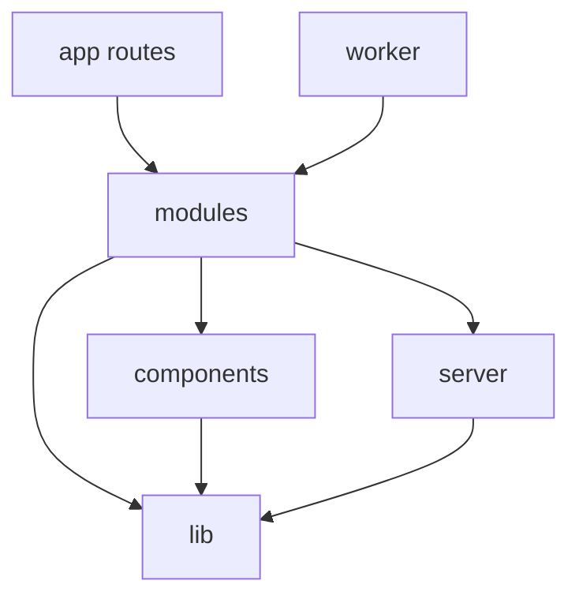

# Project Structure

**Status:** Draft v1. This is the target layout; the repo currently holds only the Create Next App starter.
**Date:** 2026-11-02
**See also:** [PRD.md](PRD.md) · [Architectural.md](Architectural.md) · [Design.md](Design.md)

---

## 1. Top level

```text
ai-powered-inventory-system/
├─ src/                     All application code
├─ drizzle/                 Generated SQL migrations and hand-written RLS, triggers, partitions
├─ tests/                   Cross-module tests: isolation, e2e, load, AI evals
├─ public/                  Static assets, offline page, service worker
├─ docker/                  Dockerfiles, Compose, reverse proxy config
├─ scripts/                 CLI tasks: bootstrap developer, seed, verify audit chain
├─ docs/runbooks/           Operational procedures
├─ .github/workflows/       CI
├─ AGENTS.md                Agent notes (regenerated by next dev)
├─ PRD.md
├─ Architectural.md
├─ STRUCTURE.md
├─ Design.md
├─ components.json          shadcn config
├─ drizzle.config.ts
├─ eslint.config.mjs
├─ next.config.ts
├─ package.json
├─ playwright.config.ts
├─ tsconfig.json
└─ vitest.config.ts
```

**Migration from the starter:** move `app/` to `src/app/` and change the `@/*` alias in `tsconfig.json` from `./*` to `./src/*`. Next.js expects `proxy.ts` and `instrumentation.ts` at the same level as `app`, so both go in `src/`.

---

## 2. `src/`

```text
src/
├─ app/                     Routes only: thin files that compose modules
├─ modules/                 Business features
├─ components/              Shared UI with no business logic
├─ server/                  Server infrastructure
├─ worker/                  Background worker entry point and job wiring
├─ lib/                     Isomorphic helpers
├─ hooks/                   Shared client hooks
├─ styles/                  Themes and tokens
├─ proxy.ts                 Optimistic auth check, request ID, security headers
└─ instrumentation.ts       OpenTelemetry setup
```

---

## 3. Routes: `src/app/`

URLs describe features, not roles. A role sees different navigation and data, and `/console` holds platform-only pages.

```text
src/app/
├─ layout.tsx                         Root: fonts, pre-paint script, providers
├─ globals.css                        Tailwind entry, imports styles/
├─ global-error.tsx
├─ not-found.tsx
├─ offline/page.tsx                   Static offline fallback
│
├─ (auth)/                            Centered layout, no shell
│  ├─ layout.tsx
│  ├─ login/page.tsx
│  └─ access-denied/page.tsx          Google account isn't provisioned
│
├─ (app)/                             Sidebar + navbar shell
│  ├─ layout.tsx                      Static frame; user data streams in
│  ├─ error.tsx
│  ├─ dashboard/page.tsx              Widgets differ by role
│  ├─ inventory/
│  │  ├─ page.tsx                     All items
│  │  ├─ new/page.tsx
│  │  └─ [itemId]/
│  │     ├─ page.tsx                  Details, history, custody, activity
│  │     └─ edit/page.tsx
│  ├─ categories/
│  │  ├─ page.tsx
│  │  ├─ new/page.tsx
│  │  └─ [categoryId]/page.tsx        Column builder
│  ├─ transfers/
│  │  ├─ page.tsx
│  │  └─ [transferId]/page.tsx
│  ├─ assignments/page.tsx
│  ├─ predictions/page.tsx
│  ├─ assistant/
│  │  ├─ page.tsx
│  │  └─ [conversationId]/page.tsx
│  ├─ notifications/page.tsx
│  ├─ announcements/                  Admin: own office
│  │  ├─ page.tsx
│  │  └─ new/page.tsx
│  ├─ team/                           Admin: office users
│  │  ├─ page.tsx
│  │  ├─ new/page.tsx
│  │  └─ [userId]/page.tsx
│  ├─ activity/                       Admin: live feed and audit log
│  │  ├─ page.tsx
│  │  └─ logs/page.tsx
│  ├─ profile/page.tsx                Own profile and sessions
│  └─ settings/page.tsx               Theme, scale, notifications
│
├─ (app)/console/                     Developer only
│  ├─ layout.tsx                      requirePermission gate
│  ├─ page.tsx                        Platform overview
│  ├─ offices/
│  │  ├─ page.tsx
│  │  ├─ new/page.tsx
│  │  └─ [officeId]/page.tsx          Profile, admins, read-only inventory
│  ├─ accounts/
│  │  ├─ page.tsx
│  │  └─ [userId]/page.tsx            Profile and effective permissions
│  ├─ permissions/
│  │  ├─ page.tsx                     Grants
│  │  └─ requests/page.tsx
│  ├─ monitor/page.tsx                Live activity and presence
│  ├─ logs/page.tsx                   All audit logs
│  ├─ system/
│  │  ├─ page.tsx                     Health
│  │  └─ jobs/page.tsx                Queues and failures
│  ├─ ai/page.tsx                     Usage, cost, forecast accuracy
│  └─ announcements/page.tsx          Global announcements
│
└─ api/                               Only what Server Actions can't do
   ├─ auth/[...all]/route.ts          Better Auth
   ├─ events/route.ts                 SSE stream
   ├─ ai/chat/route.ts                Streaming assistant
   ├─ exports/[exportId]/route.ts     Signed file download
   ├─ health/route.ts
   └─ ready/route.ts
```

Each data page has a `loading.tsx` only where a route-level fallback helps. Most skeletons are inline `<Suspense>` fallbacks next to the data they stand in for.

---

## 4. Feature modules: `src/modules/`

Each module owns one business area and has the same shape. Only use what the module needs.

```text
src/modules/inventory/
├─ actions.ts          Server Actions wrapped in guard()   ('use server')
├─ queries.ts          Reads, in scope                     ('server-only')
├─ service.ts          Business rules used across modules  ('server-only')
├─ schemas.ts          Zod inputs, safe on the client
├─ types.ts            DTOs
├─ jobs.ts             Job handlers, called by src/worker
├─ events.ts           Event types emitted by this module
├─ components/         UI for this feature
└─ __tests__/
```

| Module | Owns | Main PRD reference |
|---|---|---|
| `auth` | Sign-in rules, sessions, session list | AUTH |
| `offices` | Office profiles | ORG |
| `users` | Accounts, profiles, invitations | ORG |
| `permissions` | Catalog UI, grants, requests, effective access view | PERM |
| `categories` | Categories, columns, field-schema builder | CAT |
| `inventory` | Items, stock ledger, import, export | INV |
| `custody` | Assignments, transfers | ASG |
| `notifications` | Notification center, announcements, fan-out, reminders | NTF |
| `audit` | Log viewer, chain verification | LOG |
| `monitoring` | Live feed, presence, system health | MON |
| `dashboards` | Role-based widgets and aggregates | DASH |
| `predictions` | Forecasters, backtesting, reorder logic | PRED |
| `assistant` | Chat, tools, retrieval, prompts, evals | RAG |
| `preferences` | Theme, scale, sidebar, saved views | UI |

### Import rules

Enforced with ESLint boundary rules, so structure can't quietly erode.



1. A module imports another module only through its `service.ts`, `schemas.ts` or `types.ts`, and never through `queries.ts` or `actions.ts`.
2. Files in `app/` hold composition only: no SQL, no business rules.
3. `components/` knows nothing about modules or the database.
4. Anything that touches the database imports `server-only`.
5. All tenant data access goes through `withScope`. The raw database client isn't exported beyond `server/db`, except to migrations and scripts.
6. No circular module imports.

---

## 5. Shared UI: `src/components/`

```text
src/components/
├─ ui/                  shadcn components, owned and customized (button, dialog, ...)
├─ shell/               app-sidebar, navbar, breadcrumbs, command-palette, page-header, page-container
├─ data-table/          data-table, toolbar, pagination, column-menu, filters, bulk-bar, skeleton
├─ forms/               form-field, dynamic-field (renders any custom column), submit-button
├─ feedback/            empty-state, error-state, access-denied, conflict-dialog, rate-limit-notice
├─ connectivity/        offline-banner, live-indicator, stale-badge
├─ skeletons/           kpi, chart, table, detail, form
├─ charts/              Themed chart wrappers
├─ audit/               audit-diff
└─ providers/           theme, scale, query, realtime, connectivity
```

Customize shadcn inside `components/ui/` directly, since shadcn copies its source into the project for that purpose. Compositions go in the other folders, so they aren't lost when a component is re-added.

---

## 6. Server infrastructure: `src/server/`

```text
src/server/
├─ db/
│  ├─ client.ts          Pool for the app role
│  ├─ scope.ts           withScope(): transaction + SET LOCAL
│  └─ schema/            Drizzle tables, one file per domain
├─ auth/
│  ├─ config.ts          Better Auth + Google + provisioning hook
│  └─ session.ts         getSession(), requireSession(), requirePermission()
├─ authz/
│  ├─ catalog.ts         Typed permission catalog
│  └─ resolve.ts         Effective permission resolution
├─ guard/
│  ├─ guard.ts           Mutation pipeline
│  └─ errors.ts          Typed errors
├─ audit/writer.ts       Audit insert within the transaction
├─ outbox/               Write helper and relay
├─ queue/                BullMQ connections and queue definitions
├─ realtime/             Channels, stream publishing, SSE helpers
├─ cache/
│  ├─ handler.ts         Next.js cacheHandlers implementation for Redis
│  └─ tags.ts            Typed, office-scoped tag builders
├─ rate-limit/           Sliding window and limit classes
├─ ai/
│  ├─ anthropic.ts       Claude client and model config
│  └─ embedder.ts        Embedder interface and Voyage implementation
├─ storage/              S3-compatible client, signed URLs
├─ observability/        Logger and metrics
└─ env.ts                Zod-validated environment
```

`src/worker/` holds `index.ts` (starts queues, handles `SIGTERM`), `schedules.ts` (cron definitions), and `registry.ts` (maps queues to the handlers in `modules/*/jobs.ts`).

`src/lib/` contains client-safe helpers: `format.ts`, `dates.ts`, `pagination.ts`, `url-state.ts`, `utils.ts` (`cn`).

`src/styles/` contains `tokens.css`, `themes/*.css` (one per color theme), `scale.css`, and `motion.css`.

---

## 7. Database files: `drizzle/`

```text
drizzle/
├─ migrations/         Generated by drizzle-kit, committed, never edited after merge
├─ sql/
│  ├─ rls/             Policies per table
│  ├─ triggers/        Append-only enforcement
│  ├─ functions/       The transfer function
│  └─ roles.sql        app_user / migrator roles
└─ seed/               Dev fixtures: two offices, all roles
```

---

## 8. Tests: `tests/`

```text
tests/
├─ isolation/          Enumerates office tables and routes, asserts no leakage
├─ e2e/                Playwright: journeys by role
├─ a11y/               axe across themes and scales
├─ load/               k6
├─ evals/              Assistant question sets and red-team cases
└─ fixtures/
```

Unit and integration tests sit next to the code in `__tests__/`.

---

## 9. Naming

| Item | Convention | Example |
|---|---|---|
| Files, folders | kebab-case | `stock-movement.ts` |
| Components | PascalCase export | `DataTable` |
| Hooks | `use-` file, `use` function | `use-connectivity.ts` |
| Actions | Verb + noun | `createItem` |
| Queries | `get`/`list` + noun | `listItems` |
| Permissions | `noun.verb` | `item.delete` |
| Audit actions | `noun.past-verb` | `item.deleted` |
| Events | `domain.past-verb` | `transfer.completed` |
| Tables, columns | singular snake_case | `stock_movement.occurred_at` |
| Cache tags | `office:{id}:{thing}` | `office:abc:stats` |
| Queues | lowercase noun | `announcements` |

---

## 10. Adding a feature

1. Add permissions to `server/authz/catalog.ts`.
2. Add the table to `server/db/schema/`. If it holds office data, add `office_id`, RLS SQL and a composite foreign key. The isolation test fails until this is done.
3. Generate the migration.
4. Create `modules/<feature>/`: schemas, queries, actions (through `guard`), and components.
5. Add a thin route in `app/`, with a skeleton and error state.
6. Add it to navigation with its permission.
7. Add tests, including a cross-office attempt.

---

## 11. Environment variables

Validated by `server/env.ts` at boot, so a bad deploy fails immediately. `.env.example` is committed and contains no real values.

| Variable | Purpose |
|---|---|
| `DATABASE_URL`, `DATABASE_MIGRATOR_URL` | App role and migration role |
| `REDIS_URL` | Limits, queues, event streams, cache |
| `BETTER_AUTH_SECRET`, `BETTER_AUTH_URL` | Sessions |
| `GOOGLE_CLIENT_ID`, `GOOGLE_CLIENT_SECRET` | Sign-in |
| `GOOGLE_ALLOWED_HD` | Optional Workspace domain restriction |
| `BOOTSTRAP_DEVELOPER_EMAIL` | First Developer (used by the CLI only) |
| `ANTHROPIC_API_KEY`, `AI_MODEL` | Assistant |
| `VOYAGE_API_KEY`, `EMBEDDING_MODEL` | Embeddings |
| `S3_ENDPOINT`, `S3_BUCKET`, `S3_ACCESS_KEY`, `S3_SECRET_KEY` | Files |
| `NEXT_SERVER_ACTIONS_ENCRYPTION_KEY`, `DEPLOYMENT_VERSION` | Multi-instance deploys |
| `OTEL_EXPORTER_OTLP_ENDPOINT`, `SENTRY_DSN` | Observability |

---

## 12. Scripts

| Script | Purpose |
|---|---|
| `dev` | Next.js dev server |
| `dev:worker` | Worker with reload |
| `build`, `start` | Production web |
| `start:worker` | Production worker |
| `lint`, `typecheck` | Static checks |
| `test`, `test:isolation`, `test:e2e`, `test:evals` | Tests |
| `db:generate`, `db:migrate`, `db:seed` | Database |
| `bootstrap:developer` | Create the first Developer |
| `audit:verify` | Verify the audit hash chain |
